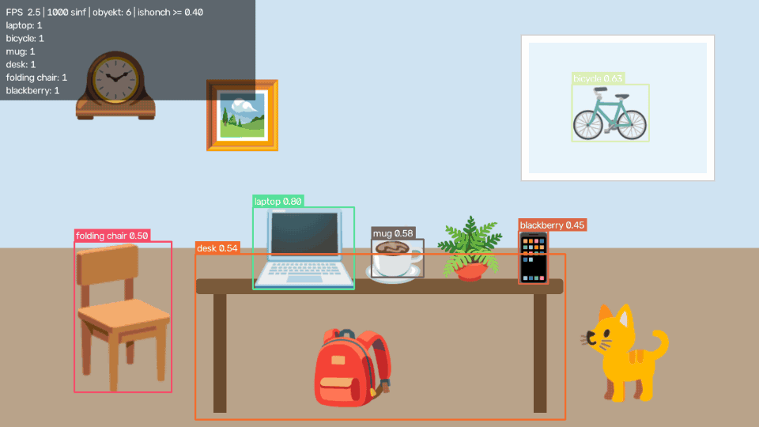
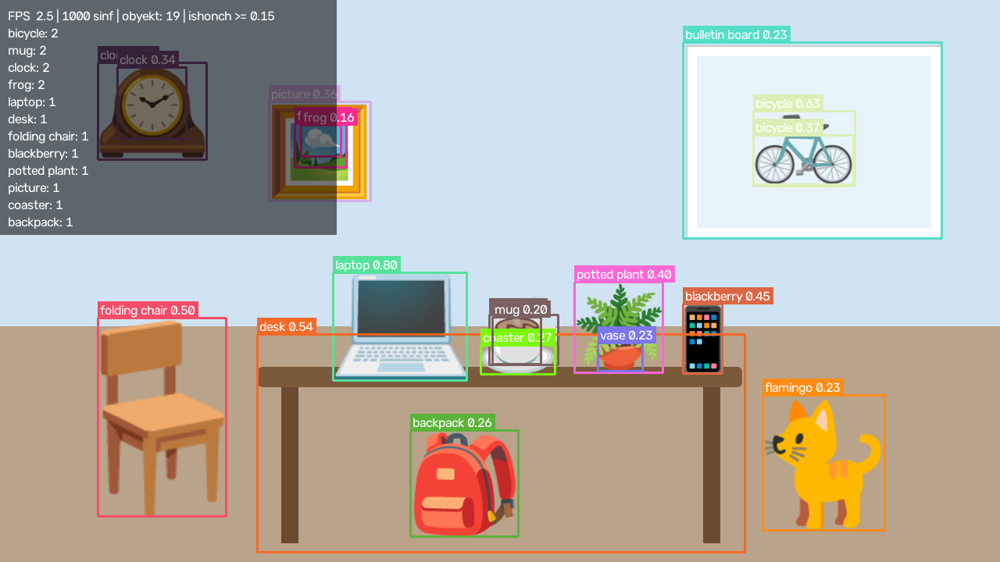
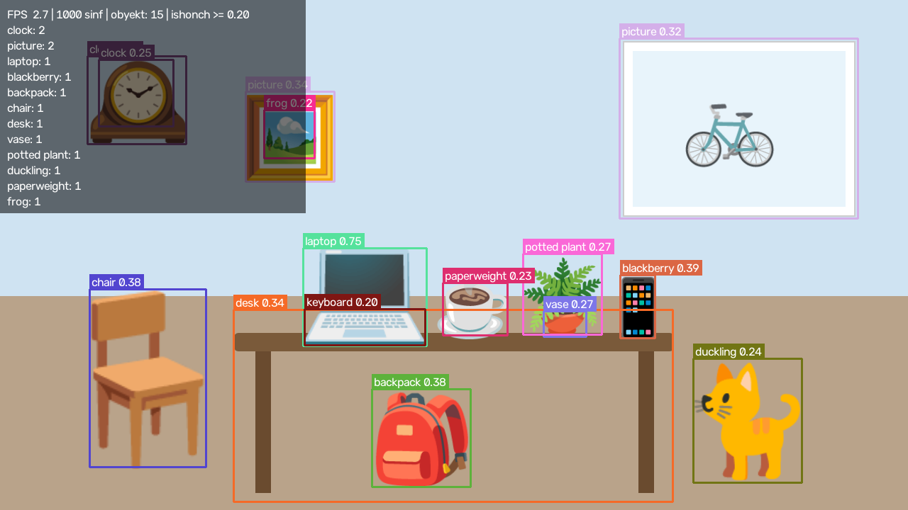
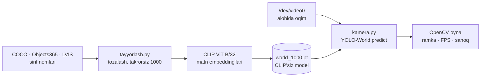

<div align="center">



**Oddiy noutbuk kamerasida, GPU'siz, 1000 xil buyumni real vaqtda aniqlaydigan kichik dastur:** YOLO-World modeliga COCO, Objects365 va LVIS sinflaridan yig'ilgan 1000 ta nom bir marta «o'rnatiladi», keyin kamera CLIP'siz, yengil ishlaydi.


</div>

---

## Ishonch chegarasi

<div align="center">

</div>

Kamera oynasida `+` / `-` tugmalari ishonch chegarasini 0,05 qadam bilan o'zgartiradi. 1000 sinfda model ishonchi tabiiy ravishda past chiqadi, shuning uchun sukut 0,20 va sinflararo NMS (`agnostic_nms`) yoqilgan — bitta buyumga bir nechta nom yopishmasin.

## Qanday ishlaydi

| | |
|---|---|
| 📚 **1000 sinf** | `tayyorlash.py` COCO (80) → Objects365 (365) → LVIS (1203) nomlarini tozalaydi («airplane/aeroplane» → «airplane», «Other Shoes» → «shoes»), birlik/ko'plik takrorlarini olib tashlaydi va birinchi 1000 tasini oladi — kundalik buyumlar ro'yxat boshida |
| 🧠 **Bir martalik CLIP** | Sinf nomlari CLIP bilan bir marta kodlanadi va `world_1000.pt` ga saqlanadi; `clip_model = None` — kamera ishlaganda CLIP xotiraga yuklanmaydi |
| 🎥 **Kechikishsiz kadr** | Kamera alohida oqimda o'qiladi: model sekin bo'lsa ham har safar **eng yangi** kadr olinadi, navbat to'planmaydi (MJPG, 1280×720, V4L2) |
| 🖼️ **Ekran** | Har ramka sinfga bog'liq barqaror rang bilan; chap tepada FPS, obyektlar soni va eng ko'p uchragan 12 sinf |
| ⌨️ **Boshqaruv** | `q`/`Esc` — chiqish · `+`/`-` — ishonch chegarasi · `s` — kadrni saqlash · `--sinov N` — oynasiz N kadr va o'rtacha vaqt |

## Natija (sintetik sahna)

<table>
<tr>
<td width="50%"><br/><sub><b>imgsz 640, ishonch 0,15</b> — 19 obyekt</sub></td>
<td width="50%"><br/><sub><b>imgsz 480, ishonch 0,20</b> — kamera sukuti</sub></td>
</tr>
<tr>
<td><br/><sub><b>Kirish kadri</b> — emoji'lardan yig'ilgan sun'iy xona</sub></td>
<td></td>
</tr>
</table>

> Haqiqiy kamera kadri ishlatilmagan: kirish — Noto Color Emoji belgilaridan HTML'da yig'ilgan **sun'iy sahna**. Natija xatolari bilan, qanday chiqqan bo'lsa shunday ko'rsatilgan: noutbuk, stul, soat, velosiped, ryukzak to'g'ri topilgan; mushuk «flamingo», telefon «blackberry» deb adashgan — 1000 sinfli ochiq lug'atning odatiy cheklovi.

## Arxitektura



## Tezlik

Shu kompyuterda (Ryzen 5 7520U, GPU yo'q) 1280×720 kadrda, 8 marta ishga tushirishning medianasi:

| imgsz | Bir kadr | ≈ FPS |
|---|---|---|
| 480 (sukut) | 374 ms | 2,7 |
| 640 | 400 ms | 2,5 |

## Ishga tushirish

```bash
python3 -m venv .venv && .venv/bin/pip install -r requirements.txt

# 1) Model og'irliklarini yuklab olish (~26 MB, Ultralytics GitHub releases)
.venv/bin/python -c "from ultralytics import YOLOWorld; YOLOWorld('yolov8s-worldv2.pt')"

# 2) 1000 sinfni bir marta o'rnatish (CLIP ViT-B/32 ~350 MB birinchi marta o'zi yuklanadi)
.venv/bin/python tayyorlash.py          # → sinflar.txt, world_1000.pt

# 3) Kamera
./ishga.sh                              # oyna (Wayland'da QT_QPA_PLATFORM=xcb)
./ishga.sh --imgsz 640 --conf 0.15      # aniqroq, sekinroq
./ishga.sh --sinov 30                   # oynasiz sinov: 30 kadr, o'rtacha vaqt
```

Model fayllari (`*.pt`, `weights/`) repoga kirmaydi.

## Sifat

- Avtomatik sinovlar yo'q.
- Tekshirilgani: `world_1000.pt` bilan sintetik sahnada yuqoridagi natija va vaqtlar shu kompyuterda o'lchangan.

## Texnologiyalar

Python · Ultralytics YOLO-World v2 (yolov8s-worldv2) · CLIP ViT-B/32 · PyTorch (CPU) · OpenCV (V4L2, Qt oyna)

---

<div align="center">

**Manba kodi ochiq.** Savol va hamkorlik bo'yicha: Telegram [@Humoyun_Davronov](https://t.me/Humoyun_Davronov)

<sub>Muallif — Humoyun Davronov</sub>

</div>
